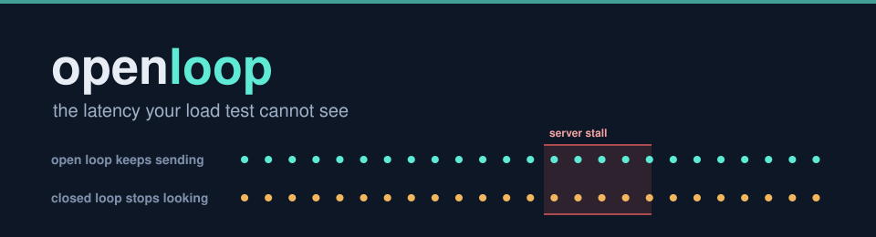
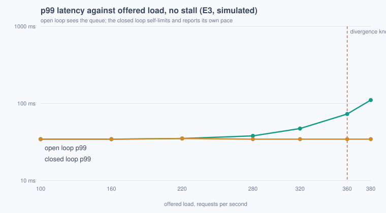
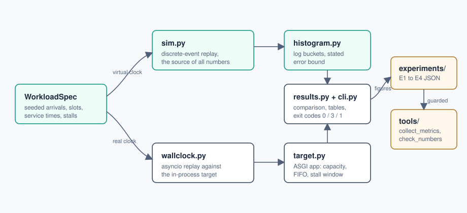

<p align="center">
  
</p>

# openloop

**Measures coordinated omission: how much a closed-loop load generator under-reports the latency an
independent client would actually experience, by replaying one seeded workload through both kinds of
generator and publishing the gap.**

<p>
  
  
  
  
</p>

Three questions this answers that a load test usually cannot:

1. A closed-loop generator waits for each response before sending the next request, so when the
   server stalls, the generator stops sending. How many requests did it silently never send, and
   what would they have measured?
2. Which quantile can even see a given stall? Visibility is arithmetic, not virtue: a quantile q
   only reports a disturbance whose share of samples exceeds 100 minus q percent, and that share is
   different for the two generators looking at the same server.
3. With no stall at all, at what offered load does a closed-loop test stop measuring the server and
   start measuring itself?

## The numbers, including the uncomfortable ones

On a server that pauses for 500 ms every 10 seconds (the shape of a GC or a rolling freeze), the
open loop reports a p99 of 433.9 ms while the closed loop reports 18.3 ms for the same server over
the same minute: **the closed-loop generator understates the p99 it exists to measure by 23.8x**,
and it arrived at that number by quietly sending **562 fewer requests than its own schedule
intended**, 4.7 percent of its own schedule, across 6 pauses.

The number this tool would rather not publish: **replace the recurring pause with a single 500 ms
stall and the open loop's own p99 misses it too**. One stall in a 60 second window is 3.16 percent
of the open-loop samples in the stalled run shown above, but just 0.54 percent in the single-stall
run, below the 1 percent a p99 ignores, and the p99 ratio collapses to 1.17. The honest comparison
moves to the tail that can see it, where the gap is 20.3x at p99.9. A demo that shows a single
dramatic stall and quotes p99 is choosing the one quantile arrangement that flatters nobody's
production system.

Credibility line: 201 tests named as properties, 99.4 percent line and branch coverage, every
figure above re-measured in CI by `tools/collect_metrics.py` and held against this document by
`tools/check_numbers.py`, which fails the build on a stale claim.

## Quickstart

Prerequisites: Python 3.10 or newer. The core has zero runtime dependencies; the optional wall-clock
mode adds FastAPI and httpx.

```bash
pip install -e ".[dev]"

# The headline in one command (exit code 3: omission found, and that is the answer, not a crash)
python -m openloop.cli compare --seed 7 --duration-s 60 --rate-rps 200 --workers 8 \
    --server-capacity 16 --stall-start-s 5 --stall-duration-s 0.5 --stall-period-s 10

# Everything: lint, 201 tests, four experiments, receipts
make verify
```

`make verify` passes from a fresh clone with no network access.

## What one stalled minute looks like

```text
generator     sent  omitted    p50 ms    p99 ms   p99.9 ms    max ms
--------------------------------------------------------------------
open         11911        0      9.88    433.92     498.44    509.42
closed       11439      562      9.69     18.26     498.44    511.31

closed-loop p99 understates open-loop p99 by 23.8x; 562 intended requests were never sent
```

Both generators replay the same seeded schedule against the same simulated server: same capacity,
same service-time stream, same six stall windows. The open loop keeps its arrival schedule no matter
what the server does, so the queue each pause creates lands in its histogram. The closed loop sends
only when its previous response has returned, skips the slots that passed while it waited, and
measures from the moment it actually sent. Nothing in that second histogram is wrong; it is a
correct record of the wrong question.

## Which quantile can see your stall

The stall's share of recorded samples decides everything. In the recurring-pause run it is 3.16
percent of the open-loop samples and 0.42 percent of the closed-loop samples: above and below the 1
percent line, so the open p99 reports the pauses and the closed p99 does not. In the single-stall
run the open-loop share falls to 0.54 percent and both p99s go quiet; only p99.9 still testifies.
The practical reading: before trusting any percentile from any load test, divide the samples your
worst disturbance touches by the total, and compare against 100 minus q.

## Where a healthy closed-loop test starts lying

With no stall anywhere, E3 sweeps offered load against a 400 rps server (capacity 8, mean service
20 ms, measured as 400 rps of theoretical throughput). The two generators agree until queueing
begins, then diverge: at 360 rps the open-loop p99 first exceeds the closed-loop p99 by more than
the published 1.5 divergence ratio, and the gap ratio reaches 3.22 by the top of the sweep while
the closed loop sheds load it never reports having offered.

<p align="center">
  
</p>

The chart is generated from `docs/experiments/e3_sweep.json` by `tools/render_chart.py`, so the
picture cannot drift from the data. Below the knee a closed-loop test is honest; above 360 rps it
is measuring its own politeness.

## The null result that makes the rest believable

E1 runs the headline workload with the stall removed. The generators agree with a measured median
delta of 0.0 percent and a measured p99 delta of 0.0 percent, which is agreement to the histogram's
resolution: recorded values are bucket midpoints with a 0.995 percent worst-case relative error
(ADR-004), so a delta below that resolution reads as zero rather than being reported as spurious
precision. The closed loop also omits nothing on the calm workload. If these deltas were not clean,
every later comparison would be measuring the generators instead of the server.

## The bugs the measurement found

**The experiment that caught its own author.** The first run of E2 used a single 500 ms stall in a
60 second window and produced an understatement of 1.17, not a headline. That was not a broken
simulator; it was the quantile arithmetic above, discovered the honest way. The scenario moved to
recurring pauses because that is both the realistic shape and the one where p99 is the right
witness, and the single-stall result was promoted from embarrassment to finding. The test
`test_the_open_loop_wall_tail_sees_the_stall_and_the_closed_median_does_not` pins the same
arithmetic from the other side: at small sample counts the closed loop's p99 is not blind, because
four workers over fifty sends put the stall at 8 percent of its samples.

**The float boundary that hung the build.** The first periodic-stall implementation reconstructed
each window's end from a modulo phase. At a wakeup scheduled for exactly the window end, the
recomputed phase came back one ulp below the duration, the simulator believed itself still stalled,
and rescheduled a wakeup one ulp later, billions of times; the symptom was a test run that never
finished. The fix computes window bounds from the window index so the wakeup time and the in-stall
comparison are the same float expression, and
`test_the_wakeup_time_for_a_stalled_moment_is_never_itself_stalled` holds the boundary exact across
two hundred periods. Commit `29a0111` carries the full story.

**The tuple seed that crashed on arrival.** `random.Random((seed, "arrivals"))` worked nowhere:
CPython restricted seed types and the very first CLI smoke run died with a TypeError before
producing a number. Seeds are now derived strings, and `test_seeding_accepts_any_seed_integer`
exercises the path on every Python in the matrix.

## Architecture

<p align="center">
  
</p>

```text
architecture-source
WorkloadSpec (seeded arrivals, slots, service times, stalls)
  -> sim.py        discrete-event replay on a virtual clock   [source of all published numbers]
  -> wallclock.py  asyncio replay on the real clock           [witness, via target.py in-process]
  -> histogram.py  log buckets with a stated error bound
  -> results.py    comparison and omission accounting
  -> cli.py        exit codes 0 (no omission) / 3 (omission) / 1 (failed to answer)
experiments/ e1..e4 -> docs/experiments/*.json -> tools/collect_metrics.py -> tools/check_numbers.py
```

## Evidence

<p align="center">
  
</p>

The GIF is a replay of captured stdout, not a screen recording: every terminal character is the
real output of the listed commands, typed back and paced by each command's measured wall time
(segments longer than eight seconds are compressed and print their true duration).
`docs/video/manifest.json` lists every command with its exit code and duration, and
`docs/video/demo.mp4` carries the full-quality version.

## The workload fixture

Everything replays from a `WorkloadSpec`: seed, duration, offered rate, worker count, a lognormal
service-time stream, server capacity, and the stall geometry. The awkward cases are in the suite on
purpose: the calm workload where both generators must agree, the saturating workload where the
closed loop self-limits without any stall to blame, the single-stall workload where the open loop's
own p99 goes blind, the boundary where a stall window ends on an exact float, and the short wall run
where the closed p99 is not blind because the sample count is small. A fixture made only of
dramatic stalls would measure nothing.

## What this cannot measure

ADR-005 is the full statement; the short version: no kernel, no NIC, no network, so absolute
latencies here are not SLO inputs and every headline is a ratio or a count; the wall-clock runtime's
constant per-request cost is visible in E4's deltas rather than modelled, and E4's first failure
over exactly that is recorded in the ADR; the stall models a start-blocking freeze, not a crash
that drops in-flight work; and both drivers live in one event loop, which caps the wall-clock
driver's offered rate. The simulator is the receipts source precisely because the wall clock is the
witness, validated within 25 percent on the shapes that matter by E4.

## Layout, exit codes, reproduction

```text
src/openloop/        workload, sim, histogram, results, target, wallclock, cli
tests/               201 property-named tests
experiments/         e1_null, e2_stall, e3_sweep, e4_sim_vs_wall
tools/               collect_metrics, check_numbers, render_chart, record_demo
docs/                adr/ (five decisions), experiments/ (JSON), evidence/, metrics.json
```

Exit codes: `0` the measurement ran and found no omission; `3` the measurement ran and the answer
is "your closed-loop numbers are lying", which must never look like a crash; `1` the tool failed to
answer; `2` usage error. Make targets: `lint`, `test`, `experiments`, `receipts`, and `verify`,
which is all of them. The receipts checker matches anchor phrases rather than bare digits because a
digit check passes while the sentence around it goes stale, and small numbers appear everywhere by
coincidence.

## Tech stack

| Technology | Role here | Why this one |
|---|---|---|
| Python stdlib (heapq, random, dataclasses) | the simulator | determinism across the CI matrix is what the receipts stand on; zero runtime dependencies is the proof |
| asyncio + httpx ASGI transport | wall-clock witness | the generator's own loop is the subject; a load-test framework would hide exactly what this measures (ADR-003) |
| FastAPI (optional extra) | bundled target | the recognisable mainstream shape, with real parameter refusal, isolated behind `openloop[wall]` |
| in-repo log-bucket histogram | recording | a published, tested 0.995 percent worst-case error bound beats an imported reputation (ADR-004) |
| pytest + ruff + GitHub Actions | the gate | tests as their own CI step, a 95 percent coverage floor, experiments re-measured, numbers checked |

ADRs: [ADR-001 virtual-clock receipts](docs/adr/ADR-001-virtual-clock-receipts.md),
[ADR-002 Poisson arrivals](docs/adr/ADR-002-poisson-arrivals.md),
[ADR-003 plain asyncio over a framework](docs/adr/ADR-003-plain-asyncio-over-a-framework.md),
[ADR-004 the in-repo histogram](docs/adr/ADR-004-in-repo-histogram.md),
[ADR-005 what this cannot measure](docs/adr/ADR-005-what-this-cannot-measure.md).

## The Pivot, and future work

Deliberately out of scope: distributed, multi-process load generation. The trigger for adding it is
mechanical: when a target needs an offered rate above what one event loop sustains, the wall-clock
driver saturates and its measured throughput stops tracking the spec; the simulator keeps going,
which is a divergence E4 would surface. Until a real target crosses that line, coordination
machinery would be weight without a question to answer.

A second version would want: a stall shape that severs in-flight requests (the crash signature,
distinct from the freeze this models); latency recorded from intended time inside the closed loop
as hdrhistogram-style correction, so the tool can show the correction and its limits side by side;
and percentile confidence intervals derived from sample counts, so "which quantile can see your
stall" becomes a function callers can evaluate before trusting any report. First metric to watch:
the share of a workload's worst disturbance in its recorded samples, per generator.
